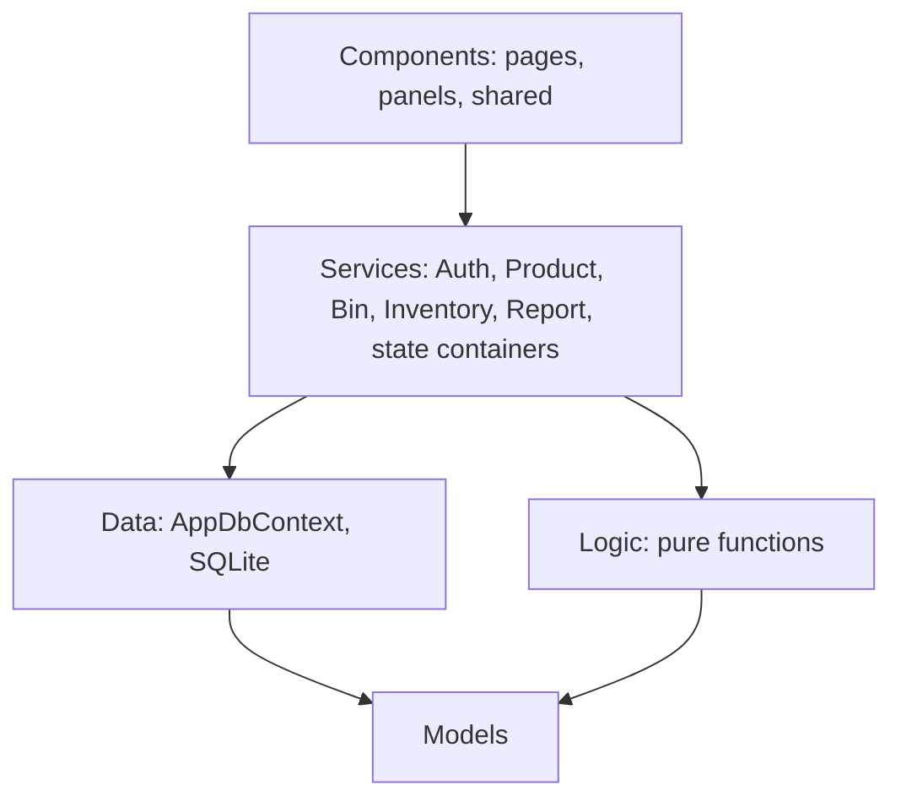
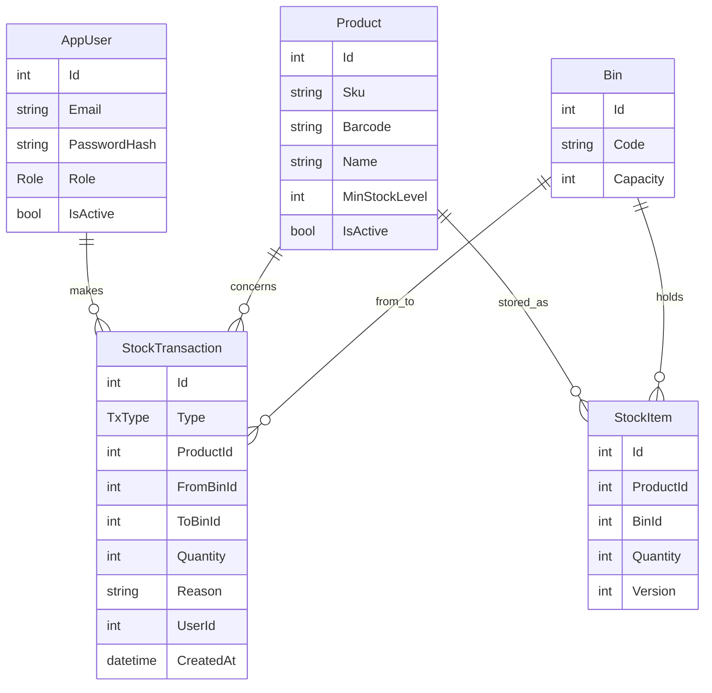
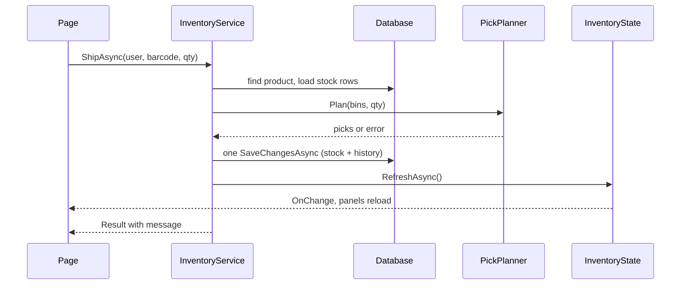

# Architecture

## Layers

Dependencies point only downwards. `Logic` depends on `Models` only, so it is tested without a database or a browser. Blazor components act as views; services and state containers act as view-models (comparable to MVVM).

## Key decisions

| Decision | Reason |
|---|---|
| `Result<T>` with `Bind` and `Map` | Business rules return success or a message; no exceptions for expected failures |
| Pure `Logic` functions | `BinAssigner`, `PickPlanner`, `ProductLogic`, `CsvExport` are easy to test |
| One `SaveChangesAsync` per operation | Stock change and history record are saved together or not at all |
| `Version` concurrency token on `StockItem` | A second writer gets "refresh and retry" instead of overwriting |
| `IDbContextFactory` | Short-lived context per operation, safe in Blazor Server |
| `AsNoTracking`, `Select`, paging in the database | Less memory, faster queries |
| State containers with `OnChange` | `SessionState`, `ToastService`, `InventoryState` refresh the UI without reload |
| Cascading `CurrentUser` | Components read the user without injecting `SessionState` |
| Roles checked in UI and services | Hiding a button is not security |
| `InventoryService` as a partial class | One file per operation |

## Entities

Database rules: unique `Email`, `Sku`, `Barcode`, bin `Code`, and `(ProductId, BinId)`; `Capacity > 0`; `StockItem.Quantity >= 0`; `StockTransaction.Quantity > 0`; index on `CreatedAt`.

## Algorithms

- **Receive (`BinAssigner`).** Fullest bin that already holds the product and has room; otherwise the smallest empty bin that fits; otherwise "No free space in any bin".
- **Ship (`PickPlanner`).** Take from the bins with the smallest quantity first; fail with "have X, need Y" if the total is too small.
- **Transfer.** Different bins, enough in the source, enough free space in the target.
- **Write-off.** Reason required, quantity not above the bin's stock.

## Ship sequence

